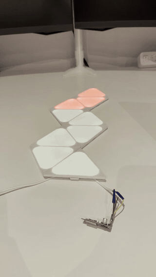
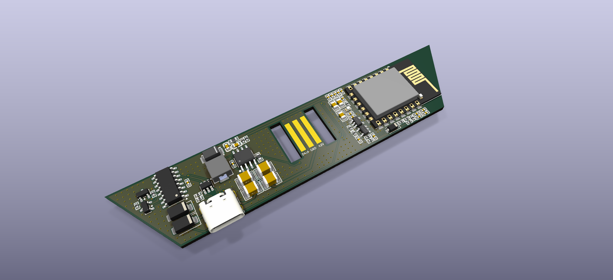
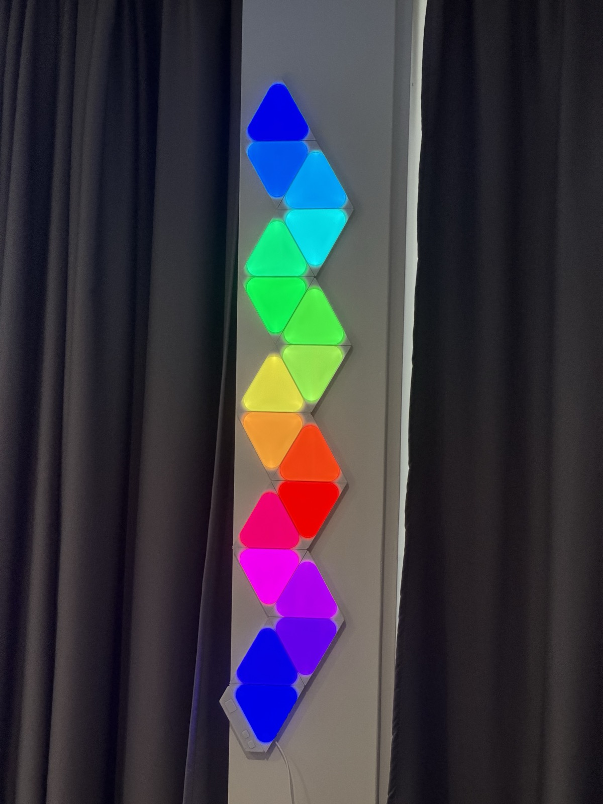
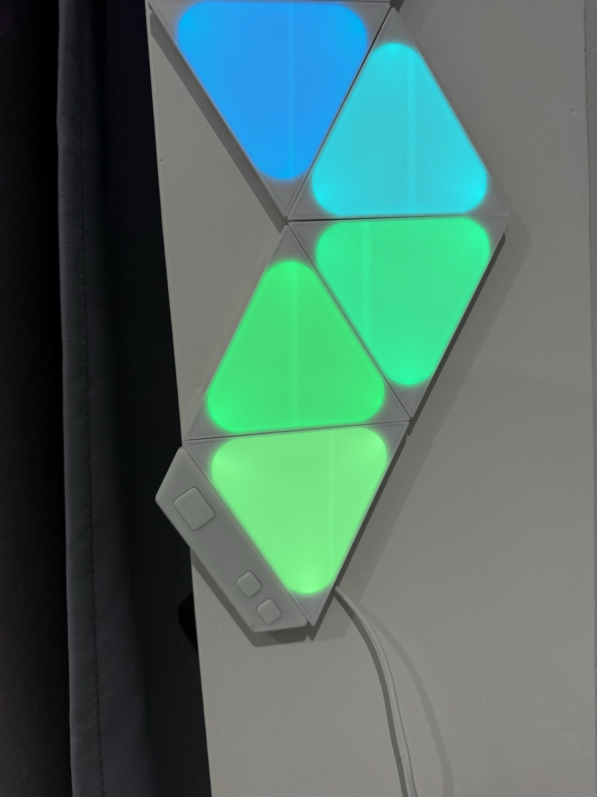

# Nanoleaf Shapes controller

An open-source replacement controller for **Nanoleaf Shapes** panels. A small interface board plugs into a
single panel edge and takes **42 V, GND and DATA** from it: no stock controller and no separate power supply.

  

<em>An early board (foreground) driving nine Mini Triangles through a cut flex linker. Click for the video.</em>

It runs one of four firmwares:

- **WLED**, through a drop-in [usermod](wled/usermod/nanoleaf_shapes/) that needs no changes to WLED itself
  (recommended), or the original [core patch](wled/core-patch/). You get effects, 2D effects laid out on the
  real panel shape, the WLED apps and Home Assistant. See [`wled/`](wled/).
- **A standalone ESP-IDF firmware** with a Wi-Fi console, status page, OTA updates and a DDP receiver. It's
  useful for bring-up, protocol work, or as a network target for another WLED instance. See [`firmware/`](firmware/).
- **Matter over Thread**, built on [esp-matter](https://github.com/espressif/esp-matter): the panels become
  one Matter colour light for Apple Home, Google Home or Home Assistant, plus a switch that runs a moving
  rainbow. It talks Thread instead of Wi-Fi and pairs over Bluetooth. See [`matter-over-thread/`](matter-over-thread/).
- **[LeafBus](https://github.com/MyrikLD/LeafBus)**, MyrikLD's original MicroPython firmware, whose protocol work
  this project builds on. The panels become a DDP and E1.31/sACN pixel sink with a layout page. It needs three
  settings on this board, and hasn't been tested on it yet; see [Running LeafBus](#running-leafbus).

> **Status:** the hardware is built and working with an ESP32-C5 module, driving 9 Mini Triangles in chain,
> fork and ring layouts, with WLED (the core-patch build), with the ESP-IDF firmware, and as a Matter light in
> a Thread network.
> Hexagons and large Triangles are handled by the code but have not been tested on real panels yet.
> **Rev B is built and working**, with USB-C flashing, three buttons on the case and a printed
> enclosure. The project files in this repository are now **rev C**, which is rev B with the faults its
> bring-up exposed. No rev C board has been fabricated. See [Current board](#current-board-rev-c).

## Repository

| Path | Contents |
|---|---|
| [`hardware/`](hardware/) | Rev C KiCad project (schematic and PCB), fabrication files in `fab/`, and the printable case STLs in `mechanical/`. Rev B is built and working, rev C is rev B with its bring-up fixes and has not been fabricated |
| [`firmware/`](firmware/) | ESP-IDF firmware |
| [`wled/`](wled/) | WLED integration: the usermod (recommended) and the original core patch, each with build instructions |
| [`matter-over-thread/`](matter-over-thread/) | Matter-over-Thread firmware (esp-matter) |
| [`docs/protocol-notes.md`](docs/protocol-notes.md) | Panel bus behaviour measured on real panels, since merged into the LeafBus spec and credited there |

## Hardware

**Power:** 42 V from `J1` goes to a TPS54360 buck converter (`U1`), which makes 3.31 V (`R2` 47k / `R3` 15k,
`R5` 330k for 295 kHz, `L1` 33 µH, `D1` SS210). That's plenty for an ESP32 with Wi-Fi.

**Panel bus:** this uses the same method as the stock controller: two 74LVC1G125 tri-state buffers.
- `U4` transmits. Its output is enabled only while TX is active, by a one-shot (`D2` 1N4148W, `R7` 10k,
  `C17` 220 pF, about 1.3 µs), so the line is released between bytes.
- `U3` always receives, so the controller hears its own echo (the firmware strips it).
- `R1` (2.2 kΩ) sits in series with the bus and `R6` (1 kΩ) with RX. `R10` (1 kΩ) lets a GPIO drive the
  one-shot node for optional RS485-style direction control.

**Module:** any 16 × 24 mm module with the ESP-12F footprint. The footprint is drawn for the Wireless-Tag
WT0132C6-S5 (ESP32-C6); the working boards use a DOIT ESPC5-12 (ESP32-C5). The module sits on the back, and
is hand-soldered along with `SW1` and `SW2`.

### Module pins

| Net | Module pin (WT0132C6-S5 numbering) | ESP32-C6 | ESP32-C5 (ESPC5-12, verified) |
|---|---|---|---|
| Bus TX | 20 | GPIO3 | GPIO26 |
| Bus RX | 19 | GPIO10 | GPIO27 |
| One-shot (RC) node | 16 | GPIO7 | GPIO6 |
| BOOT button `SW2` | 18 | GPIO9 | GPIO28 |
| UART0 RX / TX | 21 / 22 | GPIO17 / GPIO16 | GPIO12 / GPIO11 |

For other modules, the ESP-IDF firmware finds the bus pins itself (`pinscan`) by exercising the on-board
`U4` → `U3` loopback.

### Connectors

| Connector | Pin 1 | Pin 2 | Pin 3 |
|---|---|---|---|
| `J1`, to a panel | 42 V | GND | DATA |

`J1` is three bare pads, not a header: the board clips beside a panel on a standard rigid Nanoleaf linker
and the linker's spring contacts press on them. There is nothing to wire up, and nothing to get the wrong
way round.

### Power and safety

- **Powered from the panels through `J1`:** the normal mode, and on a rev B board the only one. Wi-Fi,
  Bluetooth and Thread all work reliably on it.
- **Powered from USB:** rev C adds `D5`, a second SS210 from USB VBUS to the buck input, so the board runs
  from a USB host with no panel attached. With a panel connected, that node sits at 42 V and the diode is
  reverse biased, so nothing can reach the host. Without one, the buck runs from about 4.75 V, which leaves
  only ~0.25 V over the TPS54360's minimum: fine for bench flashing at 100-300 mA, not guaranteed on a long
  thin cable. On rev B, USB is data only and flashing needs a panel attached for power.
- **`D3`, an SMAJ48A, clamps the 42 V rail.** The board gets clipped onto live panels routinely, and
  hot-plugging into ceramic input capacitors can ring well above 42 V.
- **There is no fuse and no reverse-polarity protection**, left out on purpose: the linker mates one way
  only and `J1` is three bare pads, so there is nothing to connect backwards.

## Firmware

| | WLED ([`wled/`](wled/)) | Matter ([`matter-over-thread/`](matter-over-thread/)) | ESP-IDF firmware ([`firmware/`](firmware/)) |
|---|---|---|---|
| Use | Everyday lighting: effects, apps, Home Assistant | Smart-home light: Apple Home, Google Home, Home Assistant | Bring-up, diagnostics, protocol exploration |
| Network | Wi-Fi | Thread (needs a Thread border router); pairing over Bluetooth | Wi-Fi |
| Panel colours | WLED effects, including 2D on the real layout | One colour for all panels, white temperature, brightness; a rainbow switch | Console commands, or DDP from any sender |
| Touch | Not yet wired to WLED actions | Not yet exposed | Logged; "touch light" demo |
| Updates | WLED's update page | Serial (keeps the pairing); Matter OTA is enabled but untested | HTTP OTA with rollback |
| Chips | Usermod: builds for C5 and C6, not yet run on hardware. Core patch: tested on C5, C6 untested, also compiles for C3 and S3 | C5 (tested) and C6 (builds, untested) | Tested on C5 |

All three drive the panels the same way: they enumerate the layout at start-up, poll the panels every 50 ms,
and re-enumerate when panels are added or removed while running.

### Running LeafBus

[LeafBus](https://github.com/MyrikLD/LeafBus) is written for an original ESP32 wired to the panel through a
resistor. To run it on this board, change three things (this hasn't been tested on the board yet):

1. **MicroPython v1.29 or later for your module:** [ESP32_GENERIC_C5](https://micropython.org/download/ESP32_GENERIC_C5/)
   for the ESPC5-12, or [ESP32_GENERIC_C6](https://micropython.org/download/ESP32_GENERIC_C6/) for the
   WT0132C6-S5. See [Flashing](#flashing) for download mode.
2. **This board's bus pins in `config.json`:** `"uart": {"tx": 26, "rx": 27}` on the ESP32-C5, or
   `{"tx": 3, "rx": 10}` on the ESP32-C6.
3. **`open_drain=False` where `app.py` creates the bus:**
   `panelbus.PanelBus(tx=cfg['uart']['tx'], rx=cfg['uart']['rx'], open_drain=False)`. This board doesn't need
   open drain, because its tri-state buffer releases the line after every byte. LeafBus's open-drain switch
   also writes a register that only exists on the original ESP32.

Then copy the files as in LeafBus's quick start.

## Flashing

**Flashing goes over USB-C.** `U5`, a CH340C, carries UART0 with auto-reset, so there is no separate
adapter to wire up and no buttons to hold.

- **Rev C:** the standard tooling works as it comes. `idf.py -p PORT flash`, or `esptool` with its own
  default reset.
- **Rev B:** the CH340C's handshake lines reach the two reset transistors the opposite way round from the
  circuit esptool assumes, so its reset asserts BOOT where it means to assert EN and the chip never enters
  the ROM loader. It fails as `Invalid head of packet` or `No serial data received`, which reads like a bad
  cable. Use `firmware/tools/revb_reset.py download`, flash with `--before no_reset`, then
  `firmware/tools/revb_reset.py run`. Rev B's USB is data only, so the board needs a panel attached for
  power, and 115200 is more reliable than 460800 on this link.

After the first flash, WLED and the ESP-IDF firmware update over Wi-Fi. The Matter firmware updates over
serial again; without an erase, the pairing survives.

**Switching between firmwares:** each firmware has its own flash layout, so erase the chip when switching
(`esptool write_flash --erase-all`, or `idf.py erase-flash`). That also removes Wi-Fi settings and Matter
pairings.

## Protocol

The panel bus follows [LeafBus PROTOCOL.md](https://github.com/MyrikLD/LeafBus) (MIT): 1 Mbaud 8N1, single
wire, half duplex, with the controller initiating every exchange.

The measurements taken on this board were merged into that document in September 2026 and are credited
inline, so the specification and these panels now agree. The touch and status reply (`C0`) was the notable
exception and PROTOCOL.md describes it correctly as layout string order. The `0x20` status bit on the
power supply panel, the `10` marker on the first poll after a release and the panel centre lattice went in
with it.

The raw measurements stay in [`docs/protocol-notes.md`](docs/protocol-notes.md), together with the
recorded layout strings and a check of this project's layout parser against a hexagon capture.

## Current board (rev C)

> **Rev B is built and working. Rev C has not been fabricated.** Rev C is rev B with the faults that
> building and using a rev B board exposed, listed under *What rev B testing changed* in
> [`hardware/README.md`](hardware/README.md). The circuit is otherwise unchanged, so the description
> below covers both.

Rev B was a redesign rather than a revision. It clips beside a panel on a standard rigid Nanoleaf linker,
the same way the stock controller does, and sits in a printed case the same 1 cm thick as a panel.

### The board

A 106.35 x 21.70 mm trapezoid, two layers, 1.6 mm, 63 components.

| | |
|---|---|
| Panel connection | `J1`, three bare pads that the linker's spring contacts press on, carrying DATA, GND and 42 V. They sit in a pocket in the case, and the board has slots for the linker's snap hooks, as the panels' own PCBs do |
| Power | Still the panels' own 42 V, so there is no second supply. `U1` TPS54360 buck down to 3.3 V, with `D3` SMAJ48A clamping the 42 V rail |
| MCU | `U2` keeps the ESP-12F footprint, so an ESP32-C5 or ESP32-C6 module fits. An ESPC5-12 is what is actually fitted, because 5 GHz Wi-Fi and Thread both need the C5 |
| Panel bus | `U3` and `U4` 74LVC1G125 buffers driven by an RC one-shot, plus a 100 k pull-up that holds the bus high so the ESP32-C5's boot straps read correctly with no panel attached |
| Programming | `J3` USB-C and `U5` CH340C with auto-reset, so flashing needs no buttons and no separate serial adapter. Data only, the board still takes its power from the panels |
| Buttons | Three on the back for everyday use, pressed through the case. Reset and boot are there too and come off once the board is flashed |

### The case

An FDM printed tray, a lid and three separate button caps, generated from the board rather than drawn
against it: the real footprints, courtyards and heights are read out of KiCad and turned into geometry, so
the case cannot drift from the layout. [`hardware/mechanical/`](hardware/mechanical/) holds the STLs, ready
to print.

**10.00 mm thick**, 11.00 mm across a button cap, which matches a panel. Most of that is not free: the
linker fixes 6.55 mm of it before any design choice is made, since the plate recess and the plug depth
put the board surface 4.95 mm below the outer face.

The lid clicks into the tray on four beads, the outside corners and edges are rounded, and the three
button caps drop in from the inside and are held by a ridge. The board itself carries a keepout around
`J1` so components cannot creep into the space the linker pocket needs.

**The case has been printed and fitted to a real board**, which took several rounds. The button caps
held the switches closed until the third print, and the snap fit was settled by feel rather than by the
software clearance checks, which had already turned out to be wrong more than once here. The numbers in
`mechanical/` are the ones that worked on one FDM printer with my settings, so expect to tune
them for yours. See [`hardware/README.md`](hardware/README.md) for what specifically to watch.

  
  

<em>The board in its printed case, clipped to a panel edge and driving the run. The three caps are
the power, colour and brightness buttons.</em>

### Fabrication

`hardware/fab/pcbway/` holds the gerbers, drill files, BOM and centroid file, generated from the
current board, with a JLCPCB set alongside it. These are the rev C files. The rev B set, which is what was actually sent and built, is in the git history at the
commit before rev C replaced it. The rev B boards are sponsored by
**[PCBWay](https://www.pcbway.com/)**, who also supply the assembly.

Full design notes, including what was measured and what went wrong on the way, are in
[`hardware/README.md`](hardware/README.md).

## Thanks to PCBWay

The rev B boards and their assembly are sponsored by **[PCBWay](https://www.pcbway.com/)**, who got in
touch about LeafBus and were happy to back the hardware side of it too.

The whole thing went smoothly. What stood out most was the customer service. Replies came back fast,
sometimes within minutes, and the time difference worked for me rather than against me: a question sent
during my afternoon was usually answered by the time I got up the next morning. When I asked whether the
bare contact pads for the panel linker needed ENIG, I got a straight technical answer rather than a sales
one: ENIG if I wanted stable contact resistance and wear resistance, lead free HASL is fine if the usage
cycle is low and cost matters more. For a prototype with big spring contacts that was exactly the honest
answer, and it saved me the upgrade. They were equally helpful when I asked to cut the order back to
single sided assembly so I could solder the rest myself.

The files they were sent are the rev B set, which is in the git history at the commit before rev C
replaced it. [`hardware/fab/pcbway/`](hardware/fab/pcbway/) holds the current rev C files if you want to
order a board.

**The boards arrived and they work.** One was assembled with an ESPC5-12 and has been driving panels
ever since, through the panel bus, colour, touch and Matter over Thread. The single-sided assembly came
back correctly populated, and the bare linker contact pads came out clean.

## Credits

- [LeafBus](https://github.com/MyrikLD/LeafBus) by MyrikLD: the panel protocol specification, the geometry, and the
  original MicroPython firmware (MIT).
- **Christian Panton:** this board's PCB schematic is based on his write-up and schematics in
  [Nanoleaf Shapes deepdive, part 1](https://christian.panton.org/posts/nanoleaf-ctrl-pt1/), including the
  tri-state buffer interface the stock controller uses.
- [WLED](https://github.com/wled/WLED).
- [esp-matter](https://github.com/espressif/esp-matter) by Espressif (Apache-2.0), on top of the
  [Matter SDK](https://github.com/project-chip/connectedhomeip). The Matter firmware started from its light
  example (public domain / CC0).

## License

Hardware, the ESP-IDF firmware and the Matter firmware: [GPL-3.0](LICENSE). The files in [`wled/`](wled/)
build into WLED, which is licensed under EUPL-1.2, and are provided under WLED's licence.
