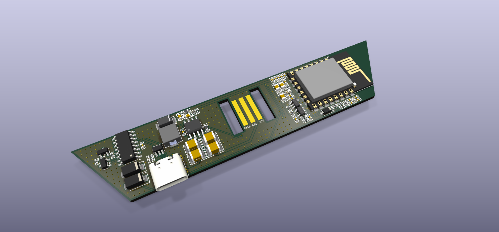
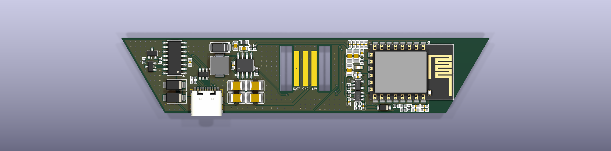

# Rev B

Rev B clips onto a panel like the stock controller, instead of connecting through a cut flex linker, and
fixes the rev A issues. It replaced rev A in this folder on 2026-10-11. Rev A is still in the git history
if you want it, at the commit before that change.

The KiCad files keep the name `nanoleaf_shapes`: the schematic stores its component references under that
project name, and renaming it would make KiCad drop every reference.

> ## Not verified
>
> **No rev B board has been built or powered up.** Boards are on order. Everything below is design intent
> and bench checking, not a working result.
>
> What has actually been checked: DRC passes with 0 errors and 0 unconnected items, ground is one
> connected body, the enclosure clears the board in a 3D fit check against the KiCad component models,
> and the fabrication files were verified against the board they came from. None of that proves the
> circuit works.
>
> Rev A, which **is** built and working, is in the git history and described in the top level README.

| | |
|---|---|
|  |  |

## Decisions

| | |
|---|---|
| Mounting | Beside a panel, joined with a standard **rigid** Nanoleaf linker, like the stock controller |
| Panel contact | Three exposed PCB pads that the linker's spring contacts press on, inside a printed pocket |
| Programming | **USB-C with a CH340C** USB-serial chip and auto-reset. Data only: the board runs from the panels |
| Enclosure | FDM-printed. The linker pocket is designed from a linker model plus caliper measurements |
| Module | ESP-12F footprint kept, so the ESP32-C5 and ESP32-C6 modules (and others) still fit |

## Keep from rev A

Both parts are verified on real panels, so they don't change:

- **Buck converter** (TPS54360, 3.31 V): no brownouts at 42 V with Wi-Fi or Thread running.
- **Bus interface** (U3/U4 buffers, D2/R7/C17 one-shot, R1, R6): 1 Mbaud, touch and hot-plug all work.

## Circuit changes

**Added after the first schematic pass:**

- **D5**, a second SS210 (`C14996`), from USB VBUS to the buck input. The TPS54360 runs from 4.5-60 V, so the
  existing buck makes 3V3 from USB with no second regulator and no ORing logic: with a panel attached the node
  sits at 42 V and the diode is reverse-biased, so **nothing can reach the host**; with no panel it conducts and
  the buck runs from ~4.75 V. That leaves only ~0.25 V over the TPS54360's minimum, so a long thin cable under
  load could drop it out -- fine for bench flashing at 100-300 mA, not guaranteed. Before this, flashing needed
  a panel connected, because U5 runs off 3V3 and VBUS reached only U6.
- **C11** changed from a 22 uF electrolytic (`C47023097`) to a 2.2 uF 100 V X7R 1210 (`C5449052`, the same part
  as C1-C3). The 6.3 mm body stands 5.4-7.7 mm tall where the linker leaves 4.95. Four 2.2 uF in parallel give
  ~6 uF derated at 42 V against the TPS54360's 3 uF ceramic minimum. The electrolytic was also damping hot-plug
  ringing; that is acceptable here only because a rigid linker's lead inductance is tens of nH.

### Earlier changes

| # | Change | Why (what happened on rev A) | Parts |
|---|---|---|---|
| 1 | **USB-C + CH340C with auto-reset** | `J2` has no GND and no reset or boot control, and an adapter's 3.3 V can't start the radios. Every serial flash needed BOOT + EN by hand, and several failed on loose wiring | USB-C receptacle (USB 2.0), CC1/CC2 5.1 kΩ to GND, CH340C (VCC = V3 = 3V3, 100 nF), 2 × NPN auto-reset (DTR/RTS → EN and the BOOT pad), ESD protection on D+/D− (USBLC6-2SC6) |
| 2 | **100 kΩ pull-up from COM to 3V3** | Without a panel, COM floats. On the ESP32-C5, bus RX is boot strap GPIO27, so download mode only worked with a panel attached. The first loopback frame without a panel also failed | 100 kΩ. U4 still pulls the far side down to about 0.07 V through R1 (2.2 kΩ) |
| 3 | **10 kΩ pull-up on module pad 11** | ESP32-C6 GPIO8 must be high for download mode; rev A leaves it floating | 10 kΩ. On the C5 this pad is GPIO15, which is neither a boot pin nor used by the flash, so the pull-up is harmless there |
| 4 | **TVS on 42 V** | The controller will be clipped onto live panels routinely. Hot-plugging into ceramic input capacitors can ring well above 42 V; the TPS54360 is rated 60 V (65 V absolute maximum). Keep C11: its ESR damps the ringing | SMAJ48A (48 V standoff) |
| 5 | **Three contact pads instead of `J1`** | The pads replace the cut flex linker. **HASL is fine** -- an earlier note here called for ENIG, on reasoning that does not hold: HASL's ~10-25 um crown on a 1.50 mm pad is nothing against a spring finger's compliance, and the linker inserts, so the springs wipe the pads as they seat rather than pressing statically on tin oxide. ENIG's immersion gold is only ~0.05-0.1 um and wears through in a few dozen matings anyway; the finish for a mated contact is hard electroplated gold, which is a different and dearer process. If a board ever misbehaves, a burnish or a dab of contact enhancer costs a few euros. | Pads per [Mechanical](#mechanical) |
| 6 | **D1 next to U1** | 16 mm on rev A, which enlarges the switching loop | Layout only |
| 7 | Status LED on module pad 18 | Shows pairing or Wi-Fi state. Optional | LED + resistor. Pad 18 is C5 GPIO8 / C6 GPIO19; neither is a boot pin |
| 8 | Test pads for COM, 3V3, GND, TX0, RX0 | Probing and a fallback serial connection | Pads only |

**Dropped:** reverse-polarity protection. The Nanoleaf connector only fits one way.

## Schematic

`nanoleaf_shapes.kicad_sch` has all the changes above. The rev A circuit is untouched, so the new parts sit in their
own block on the right of the sheet (now A3). Like the rest of the schematic, they connect through global labels.

| Refs | Part | Nets |
|---|---|---|
| J3 | USB-C receptacle (HRO TYPE-C-31-M-12 footprint) | `USB_DP`, `USB_DN`, `USB_CC1`, `USB_CC2`, `USB_VBUS`, `GND`; SBU not connected |
| R11, R12 | 5.1 kΩ | CC1, CC2 to GND (USB device) |
| U6 | USBLC6-2SC6 | ESD protection on D+/D−, referenced to `USB_VBUS` |
| U5, C22 | CH340C, 100 nF | VCC and V3 on `3V3`; TXD → `RX0`, RXD ← `TX0`; ~DTR → `DTR`, ~RTS → `RTS` |
| Q1, Q2, R13, R14 | MMBT3904, 10 kΩ | Auto-reset as on Espressif's DevKitC: Q1 pulls `BOOT` (pad 12) low, Q2 pulls `EN` low |
| R15 | 100 kΩ | `COM` to `3V3` |
| R16 | 10 kΩ | `PAD11` to `3V3` |
| D3 | SMAJ48A | `42V` to `GND`, cathode on `42V` |
| R17, D4 | 1 kΩ, 0603 LED | `LED` (pad 18) through the resistor to the LED, to `GND` |
| TP1, TP2 | Test pads | `GND`, `COM` |
| J1 | Linker pads | Footprint `nanoleaf:Nanoleaf_Linker_Pads`; 1 = 42 V, 2 = GND, 3 = COM, as before |
| J2 | Test pads | Footprint `nanoleaf:TestPads_1x03_P2.54mm`: RX0, TX0, 3V3 (with TP1 for GND) |

In the existing circuit: `EN` and `BOOT` labels on U2's pins (SW2 moved to the right to make room, same
connection), and pads 11 and 18 lost their no-connect flags.

**Checked with kicad-cli 10.0.3:** ERC gives 0 errors. The 33 warnings are all "Unspecified and Passive pins
connected", because the easyeda2kicad symbols give their pins no electrical type; rev A has 30 of them. A netlist
comparison with rev A shows every new net with exactly the intended pins, and every rev A connection intact.

**Part numbers:** the `JLCPCB` fields had copy-paste errors in rev A: J1 and U4 carried C1525 (the 100 nF
capacitor), J2 C52923, SW1 C5449052 and SW2 C4211. They didn't matter, because the rev A BOM file listed U3/U4
correctly and left the others out. Rev B fixes them: U1 C44377, U3/U4 C52140413 (from `../jlc_bom.csv`), and no
number for J1, J2, SW1 and SW2 (not assembled). J1 and J2 are now marked "not in BOM". The new parts reuse the
design's numbers where the value already exists (10 kΩ C25744, 1 kΩ C11702, 100 nF C1525). The rest still need
picking at JLCPCB; commonly used ones to check stock against are CH340C C84681, USBLC6-2SC6 C7519, MMBT3904 C20526,
HRO TYPE-C-31-M-12 C165948, 5.1 kΩ 0402 C25905 and 100 kΩ 0402 C25741, plus an SMAJ48A and a 0603 LED.

**USB ground:** with USB connected, the computer's ground joins the panels' ground. That's fine as long as the
Nanoleaf power supply's output is isolated, which is normal for a wall adapter; check it on the supply's label.

## Module pads

The KiCad footprint numbers the pads differently from the module datasheets. Footprint pads 1–8 are datasheet
pins 1–8, pads 9–16 are pins 15–22, and pads 17–22 are pins 9–14 (the short end). Checked against the pad
positions in the PCB and the pins verified on the ESP32-C5 board. Boot pins from ESP-IDF's GPIO tables:
C5 GPIO2, 7, 25, 27, 28; C6 GPIO4, 5, 8, 9, 15.

| Footprint pad | Datasheet pin | ESPC5-12 (ESP32-C5) | WT0132C6-S5 (ESP32-C6) | Rev B use |
|---|---|---|---|---|
| 3 | 3 | EN | EN | EN, auto-reset |
| 8 | 8 | 3V3 | 3V3 | |
| 9 | 15 | GND | GND | |
| 10 | 16 | GPIO6 | GPIO7 | One-shot node (R10) |
| 11 | 17 | GPIO15 | GPIO8 (boot pin) | 10 kΩ pull-up |
| 12 | 18 | GPIO28 (boot pin) | GPIO9 (boot pin) | BOOT button, auto-reset |
| 13 | 19 | GPIO27 (boot pin) | GPIO10 | Bus RX |
| 14 | 20 | GPIO26 | GPIO3 | Bus TX |
| 15 | 21 | GPIO12 (U0RXD) | GPIO17 (U0RXD) | CH340C TXD |
| 16 | 22 | GPIO11 (U0TXD) | GPIO16 (U0TXD) | CH340C RXD |
| 17 | 9 | GPIO7 (boot pin) | GPIO18 | Free: avoid |
| 18 | 10 | GPIO8 | GPIO19 | Status LED |
| 19–20 | 11–12 | GPIO9, GPIO10 | GPIO20, GPIO21 | Free |
| 21–22 | 13–14 | GPIO13, GPIO14 (native USB) | GPIO22, GPIO23 | Free |

The ESP32-C5 module brings out native USB on pads 21–22, the C6 module doesn't. The CH340C works with both.

## Board

An **upside-down isosceles trapezoid**: the long parallel side is the joint edge, against the panel, and the
legs taper away from it at 60 deg. That is not a styling choice -- a hexagon's corner is 120 deg, so each leg
is the panel's own adjacent edge continued straight through its vertex. Carried to its end the two legs would
close into an equilateral triangle; this is that triangle cut off at `CASE_DEPTH`, which is the one dimension
free to grow for the electronics.

| | |
|---|---|
| Case | 113.00 mm on the joint edge, tapering to 74.89, 33.00 mm deep. The 113 sits just inside a hexagon's 114 mm edge, so the case never overhangs the panel it joins |
| Board | 106.30 -> 72.70 mm, 29.10 mm deep, 2605 mm2 |
| Joint edge | the **case** edge, not the board edge, is the datum for every linker dimension. The plate straddles it, 20.02 mm onto the panel and 20.02 onto the case, so this line has to fall halfway along the linker or it will not reach the panel. The board sits `JOINT_INSET` = 2.00 mm inside it, leaving a wall |
| Thickness | ~11 mm, against a panel's 6 mm (10 mm mounted). Forced, not chosen: the linker eats 4.95 mm from the back face down to the PCB surface before the 1.60 mm board. The controller stands proud |

### Placement

Rev A's layout was discarded rather than extended, because its decoupling was in the wrong place -- all six
100 nF caps sat 8-14 mm from the module's 3V3 pin, in a tidy row, where trace inductance makes them useless,
and the buck's catch diode was 17.9 mm from U1 with two of three input caps 12-15 mm from VIN.

| | rev A | now |
|---|---|---|
| Module 3V3 to nearest 100 nF | 8.17 mm | **1.93 mm** (C5, C4, C6 within 3.7) |
| U1 VIN to nearest input cap | 4.36 mm | **2.51 mm** |
| U1 SW to the catch diode | n/a | **3.03 mm** |
| D1 ground to U1 ground | 17.89 mm | **9.80 mm** |

**Everything is on the front.** Rev A had the module and both buttons on the back, which makes the board
double-sided to assemble; with all 60 parts on F.Cu, JLCPCB can build the whole thing, so a populated board is
an option rather than a hand-soldering job. The cost is that the buttons face the wall, which is tolerable --
they are flashing aids, and `download` replaces them anyway.

Flipping the module to the front **mirrors it**, so it is placed at **rot 180**: at rot 0 the antenna would
point into the middle of the board and all seven signal pads would face the 3 mm strip under the joint edge.
At 180 the antenna overhangs towards the right leg and the signals fan down into open board.

| Area | Holds |
|---|---|
| top right | the module, in the corner, with its antenna pointing out along the top edge and the board past it cleared of copper on both layers |
| above it | the 3V3 decoupling row and the enable network, sitting on the module's own pins |
| top left | the buck, shifted right to clear J3. The hot loop survived the shift: VIN to the nearest input cap 2.51 mm, SW to the catch diode 2.53 mm |
| centre | the bus buffers, with COM dropping straight into them from the linker above |
| left leg | **USB**. J3 rotated 300 deg so its mouth faces out of the 60 degree bevel, with U6's ESD clamp in the nearest free slot above it |
| bottom right | auto-reset, buttons, status LED and the serial pads, under the module they talk to |

**Why the USB is on the leg, and what it cost.** Putting it there frees the whole bottom edge for the five
buttons. Every usable 16-pin USB-C footprint has four to six through-holes -- the only hole-free one in KiCad
is a 6-pin power-only part -- and on the bottom edge those holes sat under the button row. On the leg they land
at y 52.6..62.2, well clear of it.

The cost was repacking the buck: J3's rotated body reaches x 52.63, so D1, L1 and U1 all shifted right. The hot
loop came through unchanged, but three things got worse:

- **U6, the ESD clamp, is 7.8 mm from J3's D+/D- pads** instead of ~2.4 mm. J3's own courtyard occupies
  everything beside its pads, so the nearest free slot is above it. It is still first in the signal path, ahead
  of the CH340C, which is what matters most -- but closer would be better.
- the compensation passives (C12, C13, R4) were displaced to wherever fits around the shifted buck;
- the CC resistors sit 6 to 12 mm from their pads, which is cosmetic since they are DC pulldowns.

**The module's printed antenna is a keepout**, x 118.0..126.4, y 48.8..67.0 (`ANTENNA` in `board.py`). It
overhangs the module's pads by 8.62 mm. Nothing is placed in it and the ground pour has a hole punched in its
polygon there -- a rule area would be the obvious way, but KiCad 10's `ZONE_FILLER` ignores those when driven
from Python.

**The corner past the antenna is cleared too.** That keepout only covers the antenna's own rectangle, and
when the outline was widened to 106.3 mm the board grew out past it with the pour following -- 163 mm2 of
board beyond x 126.4, 86% of it ground on both layers, reaching 13.6 mm into the direction the antenna
radiates. A printed antenna needs the copper cleared where it radiates, not just underneath itself. That
copper has since been removed: **0 mm2 on both layers** beyond x 126.4, and no via is placed past x 121.2.

### Why the board is this size

Width is not free: it is set by the hexagon's 114 mm edge, which the case has to sit inside. **Depth is the
only free dimension**, so it is what sets the area. The first packed layout was 43.08 mm deep and only 37% of
its front was covered in parts; at 33.00 it is **2605 mm2 against 3279, a 21% saving**, with the front about
half covered -- dense for two layers but still hand-routable.

What stops it going further: the module is 17.85 mm tall and J3 is 9.47 mm deep and has to reach the far edge,
so 27 mm is about the floor, and at that depth the bottom band gets too tight for J3 plus the bus interface.

`J2`, rev A's RX0/TX0/3V3 header, is **gone**. The CH340C gives the same UART0 over USB with auto-reset on top,
and TP1/TP2 already cover scoping the bus, so it was dead weight. If the USB path ever needs bypassing, those
signals are still reachable at U5's pins.

### User buttons

Five switches on the **back**, the room-facing side, so they can actually be pressed: **three user buttons**
-- power, brightness up, effect -- plus reset and boot, moved across from the front, which had no room left
for them and where they would have faced the wall anyway.

They sit on the **board midline, y 56.825**, and are centred on the two areas the linker cut-out leaves. The
cut-out spans x 79.61..94.06, and at the midline the board runs x 39.93..133.74, so the areas either side of
it are **39.676 mm wide each** -- symmetric by construction:

| | x | Where |
|---|---|---|
| SW3 `BTN_PWR` | 49.85 | left area, quarter point |
| SW4 `BTN_UP` | 69.69 | left area, three-quarter point |
| SW6 `BTN_FX` | 113.90 | right area, **midpoint** |

The left pair splits its area into four equal parts. SW6 is at its area's midpoint rather than a quarter
point because the brightness-down button that shared that side was removed -- it sat over the module's
printed antenna -- and FX moved to the middle of where the two had been.

Read from the back, the side being pressed, the mirroring puts them in the order **effect, brightness +,
power** from left to right.

The user buttons are **C&K PTS645**, 6 x 6 mm with four gull-wing pads -- far easier to hand-solder than the
two-pad parts, and a real MPN rather than a house number.

**On switch size.** A swap to a generic 6x6x5 SMD part was looked at and dropped: the PTS645 *is* a 6 x 6 mm
part, so the land pattern would not shrink. Its 10.19 x 6.89 mm courtyard is simply what a 6 x 6 body with
gull-wing leads needs, and Omron's B3S-1000 lands within 0.01 mm of it. The saving only arrives with a
smaller body -- Alps SKQG or XKB TS-1187A, both 5.2 mm square, come in at 8.50 x 5.50 and 7.50 x 5.60 mm,
about **40% less area, 85 mm2 across the three** -- and TS-1187A goes to 5.0 mm height, so the tall button
survives. Not done: the board is routed and DRC-clean, and 15 track ends land on these pads.

**Reset and boot are not needed in normal use.** The auto-reset circuit drives EN and BOOT from DTR/RTS, so
esptool handles both without anyone touching a button, and the firmware's `download` command covers it too.
They are kept for rev B purely as bring-up insurance: that circuit is new here and has never been tested, and
with J2 gone there is no other serial path if it misbehaves. Not the only fallback -- Q1's collector and an
EN-side pad can be shorted to TP1 with tweezers -- but a button beats tweezers on a first spin.

They cost no board area, since the back is otherwise empty, and they use the smaller 4-pad **C&K KMR2**
(5.69 x 3.69 mm courtyard against the PTS645's 10.19 x 6.89). Both sit just right of the linker cut-out at
x ~101.5, under the module they talk to: SW2's nearest pad is **1.67 mm** from the module's edge pads.
**Drop them in the next spin once auto-reset is proven**, or mark them DNP now: the pads cost nothing and can
be populated if the first boards misbehave.

### U1's thermal vias

The TPS54360 sheds its heat through its exposed pad, so that pad needs a path to the ground pour on the
back. The easyeda2kicad footprint provided one: four plated holes inside the pad. Right idea, wrong place
to put it.

Expressing them as footprint pads cost more than it bought. They carry **no pad number**, so no schematic
pin can match them -- four `net_conflict` parity warnings, and their GND net had to be set on the board by
hand rather than coming from the netlist, where an Update PCB from Schematic could quietly drop it again.
And a plated hole inside an SMD part's courtyard is exactly what `pth_inside_courtyard` looks for: two more
errors, against SW4 on the other side. The same library also gave them `*.Cu *.Paste *.Mask`, so they had
mask openings and paste apertures on *both* faces, leaving bare GND copper 0.271 mm from SW4's BTN_UP pad.

They are now **ordinary GND vias on the board**, placed by hand, and gone from both the board footprint and
the library copy (`revb_drop_thermal_pads.py`). Nothing is lost: same four holes, same 0.61 / 0.30 mm, same
net, same places, still inside the exposed pad's mask and paste window, and tented on the back by default.
Four warnings and two errors stop being asked about, and U1 matches its library again.

| via | x | y |
|---|---|---|
| | 71.32 | 53.35 |
| | 72.32 | 53.35 |
| | 71.32 | 54.35 |
| | 72.32 | 54.35 |

**What it costs: vias do not move with U1.** That is precisely why the footprint author put them in the
footprint, and why KiCad's own `SOIC-8-1EP_..._ThermalVias` does the same. Fine while U1 is placed and
routed -- but if it ever moves, the vias stay behind and nothing warns you.

The exposed pad's own paste aperture is still a solid 2.00 x 2.00 mm, 100% coverage, where KiCad's
equivalent splits it four ways at 65% and IPC-7093 wants roughly 50-80%. Unchanged and still open.

### Ordering from PCBWay rather than JLCPCB

PCBWay has **no parts library to browse** -- that is the main difference. It sources globally by manufacturer
part number through authorised distributors (Digi-Key, Mouser, Arrow, Avnet), with kitted, partial-turnkey and
full-turnkey options, and quotes by hand rather than pricing instantly online. So:

- **The LCSC `C...` numbers in the BOM mean nothing to PCBWay.** The BOM needs designator, quantity, package
  and *manufacturer part number*; for passives with no MPN, value and package are enough. No PDFs.
- **The JLCPCB basic-versus-extended distinction disappears.** Parts picked because they were "basic" lose that
  reason, though there is no cause to change anything that works.
- **Spell out what must not be substituted.** The 100 V X7R ceramics on the 42 V rail are the dangerous ones:
  a substitution to a lower voltage or a Y5V dielectric breaks the design silently.
- Also needed: a pick-and-place/centroid file whose designators match the BOM, and an assembly drawing or
  silkscreen showing polarity.

To browse what is actually available, use a distributor rather than PCBWay: <https://www.lcsc.com>,
<https://www.digikey.com>, <https://www.mouser.com>. Take the MPN from there.

### Files

| File | Contents |
|---|---|
| `mechanical/board.py` | The outline, the joint datum and the linker keepouts; shared with the enclosure so the two cannot drift |
| `mechanical/revb_outline.py` | Writes the outline, the linker pads, the ground pour and the escape tracks into the board |
| `mechanical/revb_place.py` | Places all 60 parts and adds the 19 that were only ever in the schematic |
| `mechanical/revb_check.py` | Clears stale routing and checks containment, courtyards, keepouts and decoupling distances |
| `mechanical/revb_place_rest.py` | Places only the parked parts, and ties U1's thermal vias to GND |
| `mechanical/revb_centre_buttons.py` | Centres the four buttons on the midline and on the quarter points either side of the linker |
| `mechanical/revb_stitch.py` | Grid of ground stitching vias; dry run by default, `--place` to apply |
| `mechanical/revb_tent_thermal_vias.py` | Checks and fixes U1's thermal vias -- copper-only layers in the easyeda2kicad library and on the board, plus their GND net and solid zone connection. Run it after any footprint or netlist update |

They all need KiCad's own Python, for `pcbnew`:
`/Applications/KiCad/KiCad.app/Contents/Frameworks/Python.framework/Versions/3.9/bin/python3`.

### Ground stitching

**197 vias on the board, 168 of them GND.** 43 came from `revb_stitch.py`, 0.6/0.3 mm, on a
**3.0 mm grid centred on the board**, so they fall in seven straight rows at
y 47.825 to 65.825 and in straight columns. `revb_stitch.py` generates the grid and then throws away every
point that would not be a good via. Of the 219 grid points that land on the board:

| Rejected for | Count |
|---|---|
| the pour only reaches one layer there, so the via would stitch nothing | 108 |
| the antenna keepout and the board beyond it | 27 |
| too close to a pad | 26 |
| the linker slots | 8 |
| the board edge | 6 |
| a non-GND track | 1 |
| **kept** | **43** |

The pour test is the one that matters: a candidate only survives if its whole 0.6 mm pad -- centre plus four
edge probes -- sits inside the GND fill on **both** F.Cu and B.Cu. That is why the row at y 62.825 has only
two vias: the button row blocks the back pour across the middle of the bottom edge.

Clearance to other copper is checked at **0.30 mm**, three times the 0.1 mm netclass rule, so the grid keeps
its margin even where the routing is tight. The script asserts that the track, footprint and zone counts are
unchanged, and takes a timestamped backup, so it cannot disturb hand routing.

#### Stitching the re-routed board: 1.4 mm grid, 256 GND vias

The re-routed board carries the real stitching. It was built in `replan/` and **promoted to
`nanoleaf_shapes.kicad_pcb` on 2026-10-10** once DRC came back clean, so `replan/` is now a
superseded copy, since deleted. The board and schematic in `hardware/` are the live ones. Pitch went from 3.0 mm to **1.4 mm** after a
sweep (3.0 -> 42 vias, 2.5 -> 48, 2.2 -> 72, 2.0 -> 79, 1.8 -> 96, 1.6 -> 121, 1.4 -> 177), giving **15 rows**
and **256 GND vias** on the board as shipped: the grid contributed 177, `revb_fix_islands.py` added the two
that rescue stranded ground pins, one was dropped as too close to Q2, and the rest were placed by hand. Of 1005 grid points on the board:

| Rejected for | Count |
|---|---|
| the pour only reaches one layer there | 495 |
| the antenna keepout and the board beyond it | 124 |
| too close to a pad | 93 |
| the board edge | 66 |
| a non-GND track | 32 |
| the linker slots | 16 |
| hole to hole | 2 |
| **kept** | **177** |

The result is **one** connected body of ground copper, 2221 mm² over 16 islands on both layers, and DRC
reports **0 errors and 0 unconnected items**. What is left over is four fill artifacts at the zone boundary --
a 0.142 mm² hairline 0.01 mm wide and three zero-area specks -- all an order of magnitude below the 0.1 mm
minimum feature any fab can etch, so no copper will actually exist there.

#### Two ground pins the grid could not reach

A grid alone was not enough. Two F.Cu pours stayed electrically separate, and each held a **ground pin**:

| Island | Area | Stranded pin |
|---|---|---|
| x 54.35..58.00, y 51.42..56.85 | 4.03 mm² | `U6.2`, GND of the USBLC6-2SC6 USB ESD array |
| x 99.61..101.24, y 59.81..62.14 | 2.07 mm² | `U3.3`, GND of the 74LVC1G125 data buffer |

`U3.3` is the buffer's own ground, so the part would not have worked. Neither island took a grid via: island A's
grid points all fell inside SW3's pad keepout, and island B is boxed in so tightly by R1 and U4 that a
breadth-first path search found **no escape on F.Cu at all** -- not a 0.25 mm track, not even 0.12 mm at 0.15 mm
clearance. A via was the only way out of island B.

`mechanical/revb_fix_islands.py` places one standard 0.6/0.3 mm via at the widest point *inside each island*,
found by binary-searching the largest free disc with KiCad's own collision test. Two details matter:

* The search has to be constrained to the island polygon, not the pour at large. The widest point *near*
  island A is in the main pour a fraction of a millimetre outside it, and a via there stitches nothing.
* A `pad_standoff` keeps the via off pad copper so reflow cannot wick solder down the barrel. At 0.20 mm the
  via lands 0.89 mm from `U6.2` with 0.352 mm of clearance -- close enough to keep the ESD return path short.
  Raising it to 0.40 mm buys nothing and forces the via into a 0.203 mm gap instead.

Island B's via clears `R1.1` by **0.205 mm** against the board's 0.200 mm minimum. It passes, but it is the
tightest copper on the board; nudging R1 a tenth of a millimetre would make it comfortable.

#### Why a hand-written clearance test is not good enough

The 1.4 mm grid dropped one via 0.131 mm from `Q2` pad 3, under the 0.200 mm minimum. The test compared
against `GetSize()`, which is in the pad's **own frame**: Q2 sits at 90 deg, so its 1.475 x 0.600 mm pad read
as 0.600 x 1.475 and the via cleared on the y axis by arithmetic that described a pad in the wrong
orientation. The same code also filtered tracks on `GetClass() == "PCB_TRACK"`, which skips `PCB_ARC`
entirely, and approximated every pad as a rectangle.

`revb_stitch.py` now asks KiCad instead -- `GetEffectiveShape(layer).Collide(disc, clearance)` -- which is
exact and covers rotation, roundrects, ovals, custom pad shapes and arcs for free. An audit of all 229 vias
with the exact test found exactly one violation, the Q2 one, and it is gone. The 24 vias sitting between
0.20 and 0.30 mm are all hand-placed and legal.

### State

DRC: **0 errors, 0 unconnected items, 0 schematic-parity issues.** 15 violations, all warnings, all
cosmetic:

| | |
|---|---|
| 10 silkscreen | 7 `silk_overlap`, 2 `silk_edge_clearance`, 1 `silk_over_copper`. PCBWay clips silk off pads anyway. |
| 3x `text_height` | J1's DATA/GND/42V labels at 0.6 mm against a 0.8 mm rule. Deliberate -- they have to fit on the tongue. |
| 2x `lib_footprint_mismatch` | J3 and U5, both **1 nm rounding noise**: a few line endpoints stored as `4.699999` where the library has `4.7`. Pads, layers, shapes and polygons are identical. |

The errors that used to sit here are gone for three different reasons, worth keeping apart: the two
`pth_inside_courtyard` and the four `net_conflict` went when U1's thermal vias stopped being footprint
pads; the two `clearance` against the GND zone were a **stale pour** after a hand edit, cleared by a
refill, not by any geometry change; and U1 no longer differs from its library because the library was
corrected alongside it.

**Board and schematic agree exactly**: 63 symbol instances, 63 footprints, identical reference lists, and
every footprint has all of its pads inside the outline. Nothing is parked off-board.

**42 V creepage** was re-checked after the netclass clearance was dropped to 0.1 mm: the tightest same-layer
gap on the 42 V net is **0.200 mm**, to C1 pad 2 on F.Cu. IPC-2221 wants 0.13 mm for 31-50 V under solder
mask, so the lowered clearance has not compromised it.

## Mechanical

From Christian Panton's [write-up](https://christian.panton.org/posts/nanoleaf-ctrl-pt1/): the linker tabs carry
the spring contacts, and the devices (panels, power supply, controller) only have exposed PCB pads, held in place
by the moulded case. His pads measure **about 10 × 1.5 mm with 1 mm gaps**. The pad order is 42 V, GND, DATA,
with GND in the middle.

### Linker geometry

From [Nanoleaf Panel Connector](https://www.printables.com/model/997500-nanoleaf-panel-connector) by thegestalt,
a printable contactless linker that clips into the panels. It is licensed CC BY-NC, so it's used here only as a
dimensional reference: neither the STL nor a remix of it goes into this GPL-3.0 repository, and the pocket is
modelled from the numbers below.

| Feature | Size |
|---|---|
| Base plate | 17.3 × 40.0 mm, 2.37 mm thick, 2.0 mm corner radius. It sits in a recess in each panel's back, flush |
| Plug, one per end | 11.4 mm wide × 12.5 mm long, 2.5 mm tall; the outer end is chamfered |
| Gap between the two plugs | 9.0 mm, so a pocket starts about 4.5 mm in from its panel's edge |
| Plug corners | 3.0 mm radius |
| Snap hooks | Two per plug, one on each side, 2.7 mm wide, centred along the plug (4.9–7.6 mm from either end) |
| Locating posts | Plain, non-grabbing posts beside the hooks, found on a real linker by the test print below. They need the PCB slot to run the plug's whole length, not just the hook band |
| Hook barbs | Stick out 0.41 mm past the plug sides, widest 3.08 mm below the plate's inner face, which is 0.6 mm *below* the plug top; hook tips reach 3.63 mm below it |

### Pads and pocket

- **Plate recess:** the panels have a recess for the linker plate, so a fitted linker is flush with the back. The
  enclosure gets the same recess, 2.37 mm deep.
- **Pad depth:** the plug's flat top lands (almost) on the pads, and the linker's springs press on them from
  there. So the PCB surface sits 2.48 mm below the recess floor, plus a 0.1 mm gap: 4.95 mm below the
  enclosure's back.
- **Pad order**, measured on a panel: seen from the back of a panel with its edge at the bottom, 42 V is the left
  pad. The linker crosses the outer contacts over, so the controller follows the same rule as a panel. **Seen
  from the pad side with the joint at the top, the pads are DATA, GND, 42 V from left to right.**
- **Slots beside the pads:** the hooks reach deeper than the pads, so the PCB is cut away beside each one and the
  barbs snap under the pocket wall into the gap. A real linker also has plain locating posts, so the cut runs the
  **whole length of the plug** rather than only the hook band: 3.30 × 13.10 mm each side. The panels' own PCBs have
  the same full-length slots, and theirs are wider still. The outer edge is deliberately far outboard of the
  modelled barb (`SLOT_OUT` 1.20 mm, not `BARB_OUT` 0.41): the slot must never be what stops the barb springing,
  and the width costs nothing out there. **It does not set how hard the linker grips** — that is
  `BARB_OUT - CLEAR`, the barb's reach past the pocket wall's inner face, and the slot plays no part in it.
- **Pad position along the linker:** the springs sit in the middle of the plug (checked on a real linker), so the
  pads are centred on it, 10.77 mm from the joint.

### Files

| File | Contents |
|---|---|
| `mechanical/linker.py` | Every linker and pad dimension, shared by the two scripts below |
| `mechanical/pocket_test.py` → `pocket_test.stl`, `pocket_test_{lower,upper}.stl` (**not committed, run the script**) | Printable test piece: the plate recess, one pocket with a PCB-height floor, and the two slots. Written whole and split at the latch ledge; pass a clearance (`python pocket_test.py 0.10`) for a tighter-gripping variant, named `_c010` |
| `mechanical/linker_footprint.py` → `nanoleaf.pretty/Nanoleaf_Linker_Pads.kicad_mod` | KiCad footprint: the three pads (bare copper, no paste), the slots on Edge.Cuts, and a courtyard for the printed pocket walls. The project's `fp-lib-table` names the library `nanoleaf` |

Both scripts run with Python 3; the test piece also needs `pip install manifold3d numpy`. Checked in software
with the linker model sitting flush in the recess: the plate and plug touch nothing, and the barbs catch under
the pocket wall after 0.3 mm of pull.

### Test print

Run `python pocket_test.py` to generate the STLs, which are not kept in the repository. Print the **split
pair**, `pocket_test_lower.stl` and `pocket_test_upper.stl`, both as they come, bottom on the bed, and stack them on the two 3 mm registration pins. Neither half has an overhang. `pocket_test.stl` is the
same block in one piece, for reference and for a resin or machined part — on FDM it prints the ledge the barb
catches as a cantilever reaching inward over the slot, so the latching corner is the droopiest point of an
overhang and rounds away. Then push one end of a real rigid linker in:

1. It clicks in and holds.
2. The linker plate sits flush in the recess, level with the top face.
3. The springs touch the floor: look for marks, or feel them compress.

If the fit is tight or loose, or it seats without latching, change `CLEAR` — run `python pocket_test.py 0.10` for
a variant. Clearance is the only lever on grip: tighter clearance, deeper grip, until the plug stops going in.

**Result, 2026-10-03:** the first print was cut only to the hook band (`HOOK_Y`), and the linker's plain locating
posts fouled the floor. The slots now span the plug (`SLOT_Y` in `linker.py`), which both the test piece and the
footprint follow. Still to measure on a panel PCB: how much wider than the hooks the real slots are.

**Result, 2026-10-04:** the linker seats fully and flush but does not latch. Two causes, both addressed, neither
confirmed yet, as there are no calipers to hand:

- the ledge was an unsupported inward cantilever, hence the split print above;
- at `BARB_OUT` 0.41 and `CLEAR` 0.20 the grip was only **0.21 mm** nominal, which FDM tolerance alone can
  swallow. `BARB_OUT` came from the community model, which was already wrong about the locating posts, so it may
  simply be larger in reality; the slot was widened outboard so that a larger barb is free to deploy.

Next print: the split pair at the default clearance, then `0.10` if it still will not catch. If the tighter one
latches, the barb is real and the grip was the problem; if neither does, measure a real barb before changing
anything else.

### Enclosure

Two printed parts: a **tray** the board drops into, and a **lid** carrying the three back buttons.
`enclosure.py` builds both, `board_mock.py` builds a printable stand-in for the assembled board, and both
read `parts.json`, which `export_parts.py` writes out of the board under KiCad's Python. So the case is
cut to the board KiCad actually has, not to a drawing of it.

**Nothing in the thickness direction is a free choice until the board's back face.** The linker fixes the
first three rows: the case edge has to fall halfway along the linker, and `pocket_test.py` proved the
recess and pocket against a real one.

| z | | |
|---|---|---|
| 0.00 | outer face, **wall-facing** | the linker plate recesses into this |
| 2.37 | plate recess floor | `PLATE_T` |
| 1.10 | component cavity ceiling | 3.85 mm clear, for J3's 3.50 |
| 4.95 | board, front surface | `+ PLUG_H 2.48 + TOP_GAP 0.10` |
| 6.55 | board, back surface | `+ BOARD_T 1.60` |
| 8.05 | top of the back parts | `+ 1.50`, the user buttons |
| 8.40 | lid inner face, the seam | `+ BACK_GAP 0.35` |
| 10.00 | outer face, **room-facing** | `+ LID_T 1.60` |

**Total 10.00 mm**, and 11.00 mm across a button pad -- the same 1 cm as a panel. The board's front faces the wall, because that is
the side the linker pads are on, which is what puts the buttons on the room side where they can be pressed.

**One open cavity, not a pocket per part.** The front of the board sits in open air. Giving each part its
own pocket was tried and dropped: it makes a stiffer tray, but it wraps every part in plastic 0.25 mm away,
and the buck has to shed its heat somewhere. **80% of the board's area is open to the cavity** at the board
plane.

What that costs is support, which comes back three ways. A **1.20 mm rim** round the edge, opened up
wherever a front part reaches into it. The **plate region**, solid under the recess except where a part
needs the room. And **eight 1.80 mm posts**, 3.85 mm tall, out where the rim cannot reach -- chosen, not
placed: parts, pocket and recess are subtracted from the interior, what is left is eroded by the post's own
radius to give where a centre may sit, and candidates are picked greedily furthest-from-the-rest so they
spread. They are small because the gaps between parts are a thin web rather than open blobs; at 3.00 mm
only three places took one, at 1.80 mm eight do, from x 37.8 to x 135.8.

**The linker pocket does not need the cavity filled to stop being an island -- it needs attaching.** That
is the recess wall ring's second job: running it from the outer face up to `Z_CAV_PLATE` rather than
stopping at the recess floor, it overlaps the 1.10 mm floor below it and the recess floor beside it, so the
whole plate region, pocket included, hangs off the tray proper instead of off its root at the joint edge.

**Reliefs are measured against the recess as cut.** The recess is the plate plus 0.20 mm of fitting
clearance, and for a while the relief check used the bare plate instead. That leaves a 0.20 mm band where a
part gets no relief and the shallow rule still applies -- a clash rather than a hole, which is worse. Both
now use the same outline. A part needing the floor cut back is only a problem when the floor goes under
0.60 mm: C14 and C15 take theirs to 0.78 mm, which is still a floor, and only D3 breaks through.

**The wall around the recess is carried up to the board, not just to the recess floor.** Section the case
sideways through the linker and the weak point is obvious: the pocket wall runs z 2.37..4.95, the wall
outside the recess ran z 0..3.17, and the two only shared **0.81 mm**. The entire linker block -- pocket,
walls, the thing the barbs latch under -- hung off the rest of the case through that web.

The band now goes up to `Z_PCB` wherever nothing is over it, and where something is, only as far as that
part needs rather than all the way down: a 0.45 mm resistor used to push it back as hard as a 2.80 mm
capacitor. Measured at 34 points round the recess:

| shared height with the pocket wall | before | after |
|---|---|---|
| worst | 0.81 mm | **1.63 mm** |
| median | 0.81 mm | **2.53 mm** |
| braced the full way to the board | none | **82% of the perimeter** |

Nothing is left at the old 0.81. It also carries more board: 500 mm2 against 410, still 75% open to air.

**The plate recess needs its wall put back.** Outside the plate the part pockets are cut from z 1.10,
which is *above* the recess floor at 2.37, so any pocket reaching the plate's edge opens a hole straight
into the recess. C14 and C15 did exactly that: at z 1.50 there was no material at all across the recess's
right side -- the recess and their pocket were one continuous void. It does not show up as a hole in the
projection, because something is solid at every (x, y); it is a gap in a wall, not a hole through a floor.
A 1.00 mm ring is added back around the recess, spanning only the recess's own depth. That width is set by
C3, the nearest part too tall to live under a wall, which leaves 1.18 mm; and spanning only 0..2.37 means
a part up to `Z_PCB - Z_RECESS` = 2.58 mm, D3 included, still clears it. Checked by walking 34 points
0.45 mm outside the real boundary at four depths: no breaks.

**The USB opening is the port's own shape.** It was a plain box, 11.5 x 4.3 mm, which is both bigger than
anything needs and looks like a slot. It is now two cuts. The outer one is a **9.00 x 3.20 mm stadium**,
fully rounded ends, which is what a USB-C plug is -- the shell is 8.34 x 2.56, so it clears by 0.33 and 0.32
all round -- on a centreline 1.60 mm above the board's front surface. The inner one clears the connector's
*body*, which is square in section and overhangs the board edge by 0.50 mm, so it sits inside the wall: a
9.54 x 4.00 mm rounded rectangle, hidden behind the port where nothing shows. One shape cannot do both
jobs, because a stadium wide enough to swallow that body would have to be about 10.9 mm across -- nearly
2 mm wider than the body it is hiding, and a slot again.

**The user buttons are XKB TS-1187A-B-A-B** -- 160 gf, height code A = **1.50 mm**, brass column --
replacing the 4.40 mm C&K PTS645. Only 6.55 mm of the stack is free: 4.95 is the linker and 1.60 the
board, so the switch was the only place left to save. Positions are unchanged, recomputed from the board
rather than copied: midline, the quarter points of the area left of the linker cut-out, the midpoint of
the area right of it.

That alone did not reach 10.00 mm, because the tallest thing on the back then became **SW1/SW2**, the
reset and boot switches. Their 2.50 mm was a guess; KiCad ships a real C&K STEP model for the KMR2, not a
generic shape, and it measures 1.99 -- so at 2.00 the case lands at **10.50 mm**. Dropping those two, which
is already the plan once auto-reset is proven, would take it to 10.00.

**The lid's bosses are sized from the plunger, not from a constant.** Each of these footprints draws its
pressable face as a circle at the middle of its fab outline -- PTS645 3.50 mm, TS-1187A 2.00, KMR2 1.60 --
and `export_parts.py` reads it. This matters: the boss was a fixed 3.6 mm square, which on a 2.00 mm
plunger would have landed on the switch housing and never pressed it. It was also 0.1 mm wider than the
PTS645's own plunger, so it was marginally wrong before as well.

**SW1 and SW2 do not size the case.** They are fitted for bring-up and desoldered before the board goes
in, so `export_parts.py` marks them `in_case: false` and the enclosure, the mock and the fit check all skip
them. This is not DNP -- they are on the board and in the BOM, it only means the case need not make room
for them. It matters because at 2.00 mm they are taller than the 1.50 mm user buttons, and leaving them in
the sum put the case at 10.50 instead of 10.00.

**10.00 mm is the floor worth taking.** Of it, **6.55 cannot move**: 4.95 is the linker, proven against a
real one, and 1.60 is the board. The rest is 1.50 of switch, 0.35 of clearance and a 1.60 lid. Thinning the
lid to 1.20 would give 9.60, but the lid carries the button flexures -- already thinned to 0.70 within that
1.60 -- and the lip that clamps the board, so it is the wrong place to save. Dropping the clearance to 0.25
gives 9.90 and spends the tolerance that keeps the bosses off the switches on a printed part.

Going from 10.50 to 10.00 cost nothing structurally, because it came out of air above the board rather
than out of any wall: one connected solid, one opening (the pocket), recess wall ring still a median
2.70 mm with 89% at 2.5 or more, pocket wall still 2.55 mm at the board plane, same eight posts, same
1.10 mm front floor.

**The buttons are separate prints, held captive by their own ridge.** They were integral pads on a thin
flexure ring, which assumes the lid bends every time somebody presses it -- a fatigue crack waiting to
happen in a printed part, and the thinner the case got the worse it looked. Now the lid has a stepped
opening and the button drops in from the inside:

| | |
|---|---|
| cap | the size of the old pad, standing **1.00 mm** proud of the lid |
| opening | cap **+0.25 mm per side**, a sliding fit, not a flexing one |
| ridge | cap **+1.20 mm per side**, so it overhangs the opening by **0.95 mm** and cannot pass back out |
| counterbore | **0.80 mm** deep from the lid's inner face, leaving 0.80 mm of lid above it as the step |
| boss | sized from the switch's own plunger, closing to 0.10 mm above it |

There is only `BACK_GAP` = 0.35 mm between the switch and the lid's inner face, nowhere near enough to
hang a ridge in, so the ridge lives **inside the lid's own thickness**. The switch's spring pushes the
button out until the ridge meets the step; the board stops it going the other way once assembled. Fit it
to the lid before the board goes in.

Full press is 0.10 of free play plus 0.25 of switch travel, and the counterbore is 0.80 deep, so the ridge
is still **0.45 mm into the step** at the bottom of the stroke. Checked by the build, along with the cap
clearing both the lid and the board.

*A note on how that check is written:* the first version tested whether the pressed cap still intersected
the lid, which it never does -- the whole point is a sliding fit. Captivity is engagement, not
interference, so it measures how much ridge is left under the step instead.

**`enclosure.py` checks itself.** It intersects both parts against the populated board and reports any
clash by reference. Cavities are cut to courtyards, which overstate, but the check runs against fab-layer
bodies, which do not -- so the case gives away more room than it is checked against. Both parts currently
report clear.

### The real board, from KiCad's models

`board_mock.py` draws every part as a block of its bounding box. `board_real.py` does the other thing: it
runs `kicad-cli pcb export stl`, which walks the board and writes the **actual 3D models**, so the USB
connector is a connector rather than a brick. KiCad writes that export in page coordinates with y and z
reversed, so the script turns it a half turn about X and lifts it by `Z_PCB_BACK`, which lands it in the
same frame as the tray and the lid -- a rotation, not a mirror, so the winding survives. It also rewrites
the 28 MB ASCII export as **5.5 MB binary**, the same mesh in a fifth of the space.

**It found a real error in the height table.** Exporting each part on its own and measuring it against the
table:

| | table | model | |
|---|---|---|---|
| SW3, the tactile switch | 4.30 | **4.38** | model is **taller** |
| J3, USB-C | 3.50 | 3.31 | |
| U2, the module | 3.20 | 3.19 | |
| C1, a 1210 cap | 2.80 | 1.25 | model is a generic shape |
| C14, 22uF | 1.45 | 0.65 | model is a generic shape |

So neither source wins outright: the models understate badly wherever easyeda2kicad ships a generic shape,
and overstate only for the switches. Take whichever is taller, part by part. The switch was the one that
mattered, because the lid's bosses are set off it -- at 4.30 the boss came within **0.02 mm** of the real
switch instead of the 0.10 it is meant to leave, which print tolerance alone would have turned into a
permanently pressed button. At 4.40 the case is 0.10 mm thicker and the boss clears the real model by
0.11 mm.

**It also found the USB opening was 0.12 mm out.** Slicing the receptacle model at y 68.00 shows its
cavity at **8.34 x 2.56 mm, the USB-C figure exactly, centred on z 3.23** -- so `USB_AXIS` is a measured
1.72 mm above the board's front face, not the 1.60 that was assumed. At 1.60 a plug still passed, but with
0.20 mm clearance on one side against 0.44 on the other. At 1.72 it is **0.32 mm on all four sides**.

**The case is checked against this mesh, not just against the height table.** `board_real.stl` loads as a
solid -- merge the vertices, 222 shells, `Error.NoError` -- and intersects cleanly with both tray and lid.
The test is only worth anything if it can fail, so it is run against a deliberately nudged board as well:
0.10 mm towards the room and it clashes. Nudging in each direction also shows what each limit is, and every
one turns out to be an intended contact rather than a fault -- the lid lip on the board's back face, the
posts and rim under its front, the board edge at the 0.30 mm wall fit.

| | |
|---|---|
| wall side | +0.54 mm |
| room side | +0.36 mm |
| button boss above the real switch | +0.11 mm |
| USB stadium around the real port | +0.32 mm all round |

**Printing.** The tray goes **outer face down**: the pocket wall's latching face then prints as a top
surface, which is the whole reason the pocket test had to be split, and the only bridge is the 17.34 mm
span closing the plate recess. The lid goes **button pads down**.

**The board mock comes in three files.** `board_mock_front.stl` and `board_mock_back.stl` are the halves,
split down the board's mid-plane with their parts facing up, to be glued back to back into a 1.60 mm board
-- that pair prints without a single support. `board_mock_full.stl` is the whole thing in one piece, placed
in the **case's own coordinates**, the same frame as the tray and lid, so loading all three together shows
the assembly. It needs supports to print, which is exactly why the split pair exists.

Parts are blocks of their **body**, not their courtyard. A courtyard is the room an assembly machine wants
around a part; taking it as the part makes J3 1.7 mm wider than the connector really is, and the USB
opening is quite rightly not cut for that. Checked against the case: no clash with either tray or lid, and
0.35 mm of air at each face.

**D3 is resolved.** The TVS is 2.40 mm tall and under the recess there is only 2.58 mm of case, so its
body overlapping the recess forced a relief cut past nothing. Straight down was blocked -- it had 0.18 mm
before its GND pad reached a 42 V track, and a 0.60 mm move shorted 42 V to GND outright -- so it was moved
across the board instead, to x 47.71, clear of the plate entirely. No relief, and the only opening left in
the tray is the linker pocket itself.

C14 and C15 still take the recess floor over them to **0.78 mm**, which is thin but still a floor. Only
below 0.60 mm does a relief stop being one, and nothing does that now.

*Measuring the clearance that blocked the first move needs the layer filter.* A first attempt compared D3's
pads against every track and reported a short that DRC did not see, because B.Cu tracks running under a
front-side SMD pad were being counted. Pad-to-track on the same layer is the check; pad-to-pad and
courtyards are not enough, which is how the 0.60 mm move got written in the first place.

### Next

The enclosure around the board: the pocket from this test, a USB-C opening, BOOT reachable, and the module
antenna at the edge away from the pads and the buck.

## Rebuilding the case for the promoted board

Re-run in this order; each step reads the one before it:

    /Applications/KiCad/KiCad.app/Contents/Frameworks/Python.framework/Versions/3.9/bin/python3 \
        mechanical/export_parts.py nanoleaf_shapes.kicad_pcb        # -> parts.json
    python3 mechanical/enclosure.py                                 # -> tray, lid, three caps
    python3 mechanical/board_mock.py                                # -> the printable board stand-in
    python3 mechanical/board_real.py                                # -> board_real.stl from the 3D models

Against the re-routed board the result is **10.00 mm total**, unchanged, with **0 reliefs** and **0.00 mm²**
of front-part intrusion into the 150.55 mm² brace band -- the linker pocket is solid the whole way round,
which is what J1's published keepout bought. The fit check is clear on the tray, the lid and all three caps,
and so is the stronger check against `board_real.stl`, where the only intersection left is SW1/SW2 (1.18 mm³),
desoldered before the case goes on.

Three data defects had to be fixed first, and all three were silent.

### Courtyards that exclude their own leads

`export_parts.py` trusted `F.Courtyard` whenever a footprint had one. Twelve easyeda2kicad footprints draw
that courtyard around the component **body** and leave the leads outside it. U1 is the worst:
`SOIC-8_L5.0-W4.0-P1.27-LS6.0-BL-EP2.0` is a 6.0 mm lead span inside a 3.95 mm courtyard, and its 3D model
is correctly 6.00 mm wide. A support post was therefore placed at (69.75, 57.35), resting on U1's leads --
0.034 mm³ of real interference that the courtyard-based fit check could not see, because the courtyard said
the leads were not there.

| Footprint | Pads reach outside the courtyard by |
|---|---|
| U1 `SOIC-8_...-LS6.0-BL-EP2.0` | x +0.46, **y +1.81** |
| U3, U4 `SOT-23-5_...-LS2.8-BR` | **x +1.03**, y +0.12 |
| U2 `WT0132C6-S5` | x +0.62, **y +1.02** |
| D1 `SMA_L4.3-W2.6-LS5.2-RD` | **x +1.02**, y +0.18 |
| C1, C2, C3, C11 `C1210` | **x +1.01**, y +0.38 |
| L1 `IND-SMD_L5.2-W5.2` | x +0.10, y +0.68 |
| U6 `SOT-23-6`, U5 `SOIC-16` | +0.18, +0.17 |

A further 38 footprints -- every 0402/0603/0805 passive -- carry **no courtyard at all**, and those already
fell back to the pad bounding box. The envelope is now the **union of the courtyard and the pads** in both
`export_parts.py` and `revb_linker_keepout.py`, since neither source is trustworthy alone. The keepout still
reports 0 offenders with the corrected, larger envelopes, so the pocket stays solid.

### The three user buttons had no 3D model

KiCad ships `Button_Switch_SMD:SW_Push_1P1T_XKB_TS-1187A` as a footprint only; the
`${KICAD10_3DMODEL_DIR}/Button_Switch_SMD.3dshapes/SW_Push_1P1T_XKB_TS-1187A.step` it points at does not
exist in this install. SW3, SW4 and SW6 were simply absent from `board_real.stl`, so the fit check had
nothing to check at the one place it matters most -- under the three button caps.

easyeda2kicad has the part as **C318884** (`SW-SMD_4P-L5.1-W5.1-P3.70-LS6.5-TL_H1.5`).
`mechanical/revb_add_switch_model.py` borrows that model and leaves the footprint alone: the two share an
origin, easyeda2kicad's pads at (±3.00, ±1.85) against KiCad's (±3.000, ±1.875), so no offset or rotation is
needed. It lives on the board, not in the library, so **"update footprints from symbols" will drop it** --
re-run the script if that happens.

With the model in place the switch measures a **1.29 mm body with the plunger standing 0.30 mm above it**,
1.59 mm overall, rather than the flat 1.50 mm the height table assumes. The model is about 0.1 mm oversized
throughout -- 5.20 mm across a part the footprint name calls W5.1, while the 6.50 mm lead span is exact --
so the datasheet's H1.5 is kept as the authority and nothing was changed. Worth knowing: measured against
that inflated model the cap's boss clears the plunger by only 0.015 mm, where the datasheet geometry gives
the designed 0.10 mm of free play. The caps check clear either way.

The two-tier stack this invites -- clear the 1.29 mm body under the lid, keep the plunger clearance for the
boss -- would save about 0.30 mm, and is **deliberately not taken**. 10.00 mm is a floor set by the panels,
not a budget to spend down: a panel is about 1 cm, and a controller thinner than the panels it sits against
looks wrong. The thickness work earlier in this document was about getting *down* to 1 cm from 12.80, which
is a different problem from going below it. Anything the stack gains from here is better spent on material
than on a thinner case.

### The board mock printed one half upside down

`board_mock.py` splits the board down its mid-plane so each half prints with its own parts facing up and
needs no supports. Two things in that split were wrong, and both only show up if you measure the written
STL rather than read the code.

**The back half came out parts-down.** `part_block()` stacks parts above the plate whichever side they
belong to, so both halves were *already* parts-up by the time they were built. The line

    out["back"] = out["back"].mirror((0, 0, 1)).translate((0, 0, BOARD_T))

then flipped the back half over, leaving its 0.80 mm plate on top and the switches underneath: a 1922 mm²
overhang that would print only on a raft of supports. The comment above it said the mirror was there to
make the half print parts-up, which is the opposite of what it did.

**Neither half was mirrored, and one has to be.** Both halves print glue-face-down, so mating the two glue
faces means turning one of them over -- and turning a part over is a 180° *rotation*, which mirrors x. Glue
them as they were and one side's parts land reflected. Exactly one half has to be built pre-mirrored, and it
has to be the **front**: the back half's parts already point the way they do in the case, and only the
flipped half can end up pointing the other way. The outline is a trapezoid, symmetric left to right but not
front to back, so the flip can only be about the long axis -- and the outline itself shows you if you have
it round the wrong way.

**The registration pin could never have worked.** It was added to the front half at `z = half`, which is the
*parts* face, standing among the components, while the back half's socket was cut in its glue face. A
printed pin cannot live on a glue face that prints against the bed, so both halves now carry a blind
3.70 mm × 0.60 mm socket there instead, dowelled with an offcut of 3 mm filament. The two positions are
symmetric about the centre line, so they map onto each other under the mirror and line up either way round.

Checked by reassembling the written STLs in software -- flip the front half 180° about the long axis, add
the back half -- and differencing against `board_mock_full.stl` with the same four sockets cut: **0.00014 mm³
each way**, which is mesh noise. The halves glue back into exactly the one-piece board.

| | |
|---|---|
| `board_mock_front.stl` | 3.80 cm³, 106.30 × 22.48 × 4.30 mm, pre-mirrored, flat face down |
| `board_mock_back.stl` | 1.69 cm³, 106.30 × 21.65 × 2.30 mm, true orientation, flat face down |

Print both as they are, flat face on the bed, no supports. Turn the **front** half over left-to-right and
glue it to the back. Both halves and the one-piece mock clear the tray, the lid and all three caps.

### Rounded outside, and a lid that clicks in

Two changes on 2026-10-13. The version before them is in the git history at commit `11ddc18`, under
`mechanical/case_v1_working/`, if a fallback is ever needed.

**Rounded corners and edges.** `case_profile()` now rounds its four corners by `CORNER_R` 2.00 mm,
shrinking and regrowing with round joins so the straight runs stay exactly where they were. The outer
faces are filleted by `EDGE_R` 1.00 mm: the tray's wall-facing underside and the lid's room-facing top.
Manifold has no fillet operator, so `fillet_face()` subtracts a stack of ten rings whose inset follows
a quarter circle -- smoother than the printer can resolve.

The corners cost some width. A 2 mm radius at a 60 degree corner pulls the vertex in 1.47 mm per side,
so maximum width goes **113.00 -> 110.07 mm**. That is still well inside the panel's 114 mm edge, and
`CORNER_R` is one constant if it looks too soft or too sharp.

The brace band deliberately keeps the hard outline, `case_profile(sharp=True)`. It is clipped to the
case only to stop it running off the end, and rounding there would thin it at the corners for nothing.

**A snap fit.** The lid used to just sit on. It now carries four beads on the outer face of its lip,
with four matching grooves in the tray's rim. The slot between the board edge and the rim is where this
lives, so **nothing touches the PCB** -- the beads run from board + 0.15 mm out to board + 0.45 mm,
entirely outboard of the board.

Interference is `SNAP_H` - `LIP_FIT` = 0.30 - 0.15 = **0.15 mm**, over four 14 mm beads, and each bead
ramps in from nothing over `SNAP_RAMP` 0.40 mm so the lid cams shut instead of scraping.

Measured on the built STLs:

| Lid position | Interference with the tray |
|---|---|
| seated | **0.000 mm³** -- the parts assemble |
| 0.4 mm proud | 1.680 mm³ |
| 0.8 mm proud | **4.410 mm³** -- the bead crossing the rim |
| 1.4 mm proud | 0.000 mm³ -- clear again |

That is the signature of a detent: free when closed, free when off, and a hump in between that has to be
cammed past. **`SNAP_H` is the only number to change** if the first print is too stiff or too loose;
nothing else moves with it.

**Nothing about the board fit changed.** Total thickness is still 10.00 mm, there are still 0 reliefs
under the plate recess, the brace band is still 157.95 mm² with 0.000 mm² of front-part intrusion, and
the check against `board_real.stl` is still clear on the tray, both long caps and the wide one, with the
only intersection being SW1/SW2, which come off before the case goes on.

### The linker boss is squared on the inside, rounded on the outside

The two faces of the linker block want different shapes, so they no longer share one outline.

`plate_section()` still draws the recess cut into the **outer, wall-facing** face, and it keeps its
R2.20 corners: the linker plate's own corners are R2.00 and it has to drop in. `plate_inner_section()` is
the same outline with the **far end squared**, and it is what the **inside** of the case is built from --
the boss standing into the cavity, the part-cuts over it, the brace band around it, and the support-post
keepout.

Inside the case the radius bought nothing. The rounded end tapered the boss from its full 17.74 mm down to
13.93 mm at the tip, so the end wall thinned away into a curve exactly where it is furthest from the rest
of the tray. Squared, it is 17.74 mm the whole way to the end and the far wall is a flat 3.00 mm slab.

It can only add material: the square contains the rounded outline, so the recess cut takes nothing extra
out of the outer face, and the corners it leaves standing sit outboard of the plate's own corners and
cannot touch it. The cost is 2.09 mm² of footprint, about 0.06 cm³ -- the tray goes from 7.20 to 7.26 cm³.
The brace band grows with it, 150.55 to 157.95 mm², still with 0.000 mm² of front-part intrusion.

It also squares the geometry against what J1's keepout already published, which was always a rectangle.

### Bounding-box corners are not parts

`assembled_board` drew each part as an axis-aligned box from its envelope. U2's pads run along two edges of
the module, so the corner of their bounding box lands in empty space -- and 0.317 mm past the sloped board
edge, while the nearest real U2 pad is 1.013 mm inside it. The cavity is clipped to the board outline, so it
could not give way there, and the phantom corner read as a 0.0026 mm³ clash. The board mock is now clipped
to the board outline too, which is the same limit the cavity already respects.

## Open items

- The module's 3D model is offset in the easyeda2kicad library (16x24 model, 24x16 footprint, origin 4.13 mm
  off centre). Cosmetic only; four candidate transforms were tried and none was verifiable, so it was left
  at the library default rather than carry an unverified fix.
- CH340C stock (fallback: CH343P).
- **15 footprints still have no `JLCPCB` code**, so JLCPCB cannot source them automatically: D3, D4, J1, J3,
  Q1, Q2, R11, R12, R15, SW3, SW4, SW6, U5, U6, and U2 (which carries `C9900241604` under `LCSC Part` but not
  under `JLCPCB`). SW1 and SW2 are done: TS-1088-AR02016 is **C720477**, set on both the symbol and the
  footprint. Several of the rest are in the stock-check list further up -- CH340C C84681, USBLC6-2SC6 C7519,
  MMBT3904 C20526.
- **Two `lib_footprint_mismatch` warnings, J3 and U5**, against `Connector_USB` and `Package_SO`. Same class of
  thing as the U1 mismatch chased down earlier: the board copy and the library copy differ below the printed
  precision, so a line-by-line comparison rounded to three decimals shows nothing. Harmless for fabrication --
  the board file is what gets manufactured -- but it means "update footprints from symbols" would quietly
  change J3 and U5. Worth resolving before running that command, not before ordering.
- ~~Prune the backup boards.~~ Done 2026-10-11: 84 timestamped `*-pre-*` files (34 MB), KiCad's
  `nanoleaf_shapes-backups/` (97 MB) and the superseded `replan/` (7.8 MB) are gone. The folder went from
  146 MB to 8.4 MB, and was then flattened from `hardware/rev-b/` into `hardware/` itself. `replan/` was checked first and held nothing the promoted board did not:
  every file had a counterpart here, and its board was a day older at 297 vias against 310.
  **Note that these files are still untracked**, so those backups were their only history -- there is no
  restore point behind the current board now. Rev A, which they replaced in the working tree, is still
  intact at git HEAD.
- The enclosure itself. The linker pocket is proven on the test print; the case body around this outline is
  not drawn yet.
